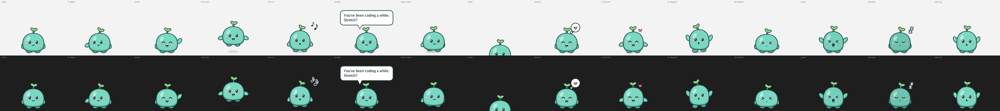
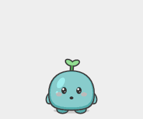
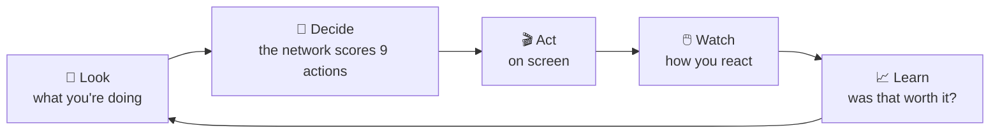
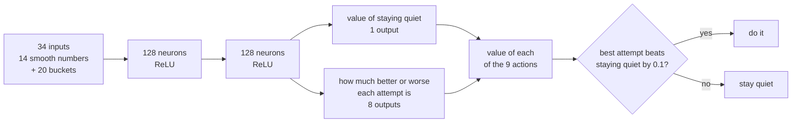
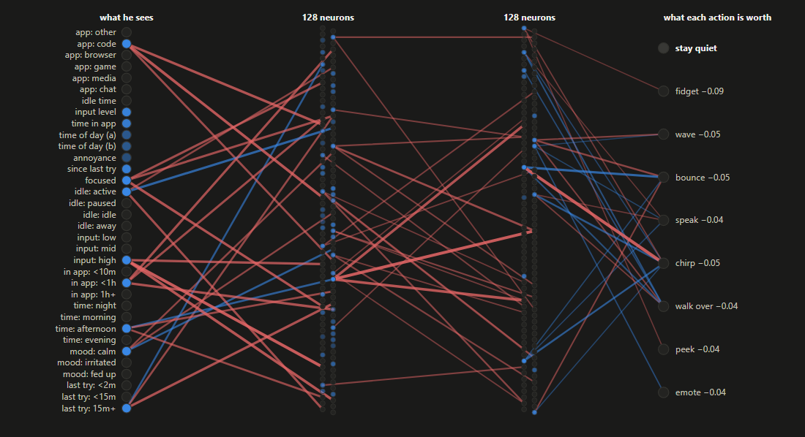
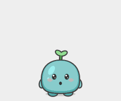

# Buddy

**A tiny desktop companion with a neural network for a brain. It learns, from you alone, when you'd like a hello and when you'd rather be left alone.**



Buddy is a small mint-green creature with a sprout on his head who lives in the corner of your Windows desktop. Every so often he tries to get your attention: a wave, a hop, a chirp, a few words, a little walk toward your cursor.

**Nobody tells him when to do that.** Under the sprout is a **deep Q-network**: 34 inputs, two layers of 128 neurons and an output for each of his nine actions, written from scratch in Go with no machine-learning framework. It learns by **reinforcement learning** from how you react. Click him and the network learns that was a good moment. Push him aside and it learns it wasn't. Over days it works out your rhythms: a hello after a coffee break is welcome, a chirp in the middle of a game is not, and pestering you twice in a row never pays.

All of it runs **on your computer**. Buddy never connects to the internet, records *when* you type but never *what*, and takes no screenshots. The network is small enough to decide in a few microseconds on the CPU.

---

## The nine actions

These are the network's nine outputs. Choosing between them is what it learns.

| | Action | What it looks like |
|---|---|---|
|  | **Stay quiet** | Nothing extra: he just breathes, blinks and sways his sprout. Most of the time this is the right call, and the network knows it. |
|  | **Fidget** | Peeks left, peeks right, hops back to the middle. Barely noticeable on purpose. |
|  | **Wave** | Raises a hand above his shoulder and waves, grinning. |
|  | **Bounce** | Two hops with a proper wind-up, stretch and landing squash. |
|  | **Chirp** | A quick hop, a little "o", a short chirp sound and two floating notes. |
|  | **Speak** | A speech bubble pops up and types out a line that fits the moment. |
|  | **Walk to you** | Hop-walks across the screen toward your mouse cursor. |
|  | **Peek** | Sinks out of sight, peeks left and right with just his sprout showing, then pops back up. |
|  | **Emote** | A little bubble over his head: a heart, a sparkle, a "!", a "?" or a music note. |

---

## His brain

Every 30 seconds, and right away when you switch apps, leave or come back, Buddy runs this loop:



### The network



It's a **dueling** Q-network. One output says how good the moment is if Buddy stays quiet, and the other eight say how much better or worse each attempt would be than that. Buddy's choices hang on small differences ("a wave is slightly better than nothing here"), so the network learns those differences directly instead of as the gap between two large numbers, where small errors would flip decisions.

It only acts when an attempt looks **at least 0.1 better** than staying quiet. Every estimate has some error, and picking the best of eight noisy estimates tends to pick whichever happens to be overrated. Without that margin, the network gets pushy.

Here is the network deciding to stay quiet while you're deep in code, from the report Buddy can show you (this brain was trained only in simulation). Lit neurons are active in this moment; grey ones are switched off by ReLU and fire in other moments. Blue connections push up, red ones push down, and every attempt ends up a little worse than staying quiet:



### What it sees

The network sees each moment **two ways at once**:

| | As smooth numbers (14 inputs) | As buckets (20 inputs) |
|---|---|---|
| **Kind of app** in front | code, browser, game, media, chat or other, one input each | |
| **Since your last key press or mouse move** | on a log scale, so 1 vs 5 minutes matters more than 101 vs 105 | active, paused, idle, away |
| **How busy your input has been** in the last minute | 0 to 1 | low, mid, high |
| **How long you've been in this app** | log scale | under 10 minutes, under an hour, longer |
| **Time of day** | two inputs on a circle, so 23:00 sits next to 00:00 | night, morning, afternoon, evening |
| **How annoyed he thinks you are** | 0 to 1 | calm, irritated, fed up |
| **How long since he last tried** | log scale | under 2 minutes, under 15, longer |
| **Whether you're focused** (typing hard right now) | 0 or 1 | |

The smooth numbers let it tell 9 minutes from 11 and learn that they're much alike, so a lesson learned on a Tuesday afternoon carries over to a Wednesday evening. The buckets let it learn sharp rules ("after an hour in the same app, things change") as easily as a lookup table could.

To tell which kind of app is in front, Buddy reads the app's name, and a browser tab's title only to tell a video site from the rest. Titles are never stored. He asks Windows *when* you last typed, never *what*. His guess at your annoyance goes up when you ignore him or push him away, and halves every 20 minutes.

### What it's rewarded for

| Your reaction | Reward |
|---|---|
| You click him | **+1** |
| You ignore him | 0 |
| You drag him out of the way | **−0.5** |
| You send him away (right-click → Go away) | **−2** |
| You play with him (wiggle him or carry him around) | 0, playing says nothing about the attempt |

Every attempt also costs a little, and interrupting while you're typing hard costs more, so the network learns **restraint**, not just timing. A reaction that comes a bit late, say a dismissal 40 seconds after a wave, still counts against the wave.

This is reinforcement learning rather than "learn what gets clicks", because his guess at your annoyance is one of the inputs: pestering you now leads to worse moments later. The network values the future with a discount of 0.9 per step, so it plans a few minutes ahead and learns that spamming never pays, even when one extra wave might get a click.

### How it learns

The network learns in two stages: practice against a simulated person before you meet, then the real thing.

**1. Practice.** A brand-new network would be clueless, and random experiments on a real person are annoying. So `buddysim` lets Buddy practice against a **simulated person**: a toy model of someone who codes, browses, games, watches videos, takes breaks and goes to bed. It's built on common sense (don't interrupt games, people like a hello after a break, and people stop noticing something that moves all the time), not on data about anyone. Practice takes a few minutes:

1. **A lookup table practices** for 2,000 simulated days by trial and error. It has a row for each of about 7,800 situations, and keeps exact running averages of how each action went.
2. **Three networks copy the table** side by side, each learning to give the table's scores on moments the table actually met (*distillation*).
3. **Each network then drives** for a few rounds while the table labels the moments it gets into, and it relearns from those (*DAgger*). A plain copy goes wrong: its small mistakes lead it into moments the table rarely saw, where the copy is worse, which leads to more mistakes. Learning from its own trips teaches it to recover.
4. **The best network is kept**, scored on simulated days none of them practiced on.

**2. Learning from you.** On your desktop the network decides, and the table becomes its **diary**:

- Every reaction you give is tallied in the diary right away. A table averages outcomes exactly, while a network learning one noisy reaction at a time can't.
- Every 200 decisions, about two hours of use, **the network studies the diary**: two passes over the last 20,000 real moments Buddy met with you, learning the diary's scores for each. Scores backed by more of your reactions count more.

So the network learns from you as reliably as the table does, while staying a network that carries lessons over to moments it has never seen.

He keeps experimenting a little: 2% of his decisions are random tries, so he can discover things the simulation got wrong. While you're typing hard, he only tries calm actions.

### What didn't work

Getting a network to learn this well took a few failed attempts, and they shaped the design:

- **Learning straight into the network**, one reaction at a time (plain deep Q-learning with replay memory and a target network), drifted and got *worse* with practice. Your reactions are too few and too noisy for that, which is why the network learns through the diary.
- **Copying the table on made-up moments**, one per table situation, failed. Real moments cluster (idle is usually exactly zero), and the network has to be right where moments actually happen, so it copies on real ones.
- **Copying without DAgger** made a network that drifted into far too many hellos, as its small errors snowballed.
- **A loophole in the simulated person.** At first, fidgeting every 30 seconds earned more clicks than any real hello, because it cost nothing and never wore off, and every brain learned to fidget nonstop. Making the simulated person habituate to constant movement, like a real one, closed it. Reinforcement learning finds loopholes like this whenever the reward allows them, so the practice partner has to be realistic.
- **A bigger network** didn't help at first, at 32 or 64 neurons per layer. It started to matter once the network had to copy the table closely, which is why it has 128.

The network doesn't quite match the table it learns from yet, in simulation. It gets much of the way, clearly beats staying silent, and uses every kind of hello. Closing that gap is ongoing work.

### Look inside

Pick **What has Buddy learned?** from the tray menu and a page opens in your browser (a local file that works offline):

- **Pick a moment.** Choose a situation (deep in code, relaxed browsing, late-night video, just sent away...) and see what the network notices, how much better or worse than staying quiet it expects each action to go, and a sentence explaining its choice.
- **Inside his neural network.** The live diagram above, for that moment. Hover over any input, neuron or connection for its numbers.
- **His playbook.** What the network would do for every kind of app and situation, morning, afternoon, evening and night.
- **How it's going.** What happened after each kind of attempt, and how often you clicked him, week by week.

For a plain-text version, run `go run ./cmd/buddy -report` (the release `buddy.exe` has no console to print to), or `buddy -report-html page.html` to save the page anywhere. A shortened example of the text version:

```text
What Buddy would do now, on a calm afternoon
app      typing hard     relaxed         just switched   2h in
code     quiet           quiet           fidget (+0.02)  speak (+0.21)
browser  quiet           wave (+0.12)    fidget (+0.03)  speak (+0.18)
game     quiet           quiet           quiet           quiet
chat     quiet           chirp (+0.14)   fidget (+0.03)  fidget (+0.04)

Is it getting better? Week by week
week of  attempts  clicked  click rate  sent away
Mar 2          31       11         35%          3
Mar 9          22       12         55%          1
```

*(Illustrative numbers.)*

---

## Getting started

You need Windows 10 or 11. To build from source you also need [Go](https://go.dev/dl/) 1.26.10 or newer. No C compiler is needed.

### From a release

1. Download `buddy-<version>-windows-amd64.zip` from the [Releases page](https://github.com/LucasAntunesdeAlmeida/buddy/releases) and unzip it anywhere you like.
2. Run `buddysim.exe` once. Buddy practices for a few minutes and saves his network.
3. Run `buddy.exe`. Buddy appears at the bottom right of your screen and in the notification area.

### From source

```sh
go run ./cmd/buddysim      # practice first, takes a few minutes
go run ./cmd/buddy         # meet Buddy
```

To build a release zip with Buddy's icon and no console window:

```powershell
.\scripts\build.ps1 -Version 1.0.0     # writes dist\buddy-1.0.0-windows-amd64.zip
```

Releases are built by CI: pushing a tag like `v1.0.0` builds that zip from the tagged commit and publishes it on the Releases page.

---

## Living with Buddy

| You | Buddy |
|---|---|
| **Click** him | Happy bounce. Teaches the network "good timing". |
| **Drag** him somewhere else | Moves there. A clear move away teaches "not now". |
| **Wiggle or carry him around** | He dangles and swings. Counts as play, not as a complaint. |
| **Right-click** him | Menu: *Go away for 30 minutes* (a strong "no"), plus everything in the tray menu. |
| **Click the tray icon** | *Pause for 1 hour*, *Sound* on/off, *Start with Windows*, *What has Buddy learned?*, *Quit Buddy*. |
| **Leave** for 5 minutes | He yawns and naps until you're back. |

Clicks on the empty space around Buddy go through to whatever is underneath, and clicking Buddy never takes the keyboard away from what you're typing in.

### Things he does on his own

These aren't decisions of the network; they're how Buddy responds to you.

| | When | What happens |
|---|---|---|
|  | You click him | A springy bounce, happy eyes and a heart. |
|  | You pick him up | He dangles, kicks his feet and swings behind the way you carry him, then lands with a squash. |
|  | You've been away 5 minutes | A big yawn and stretch, his sprout droops, and the Zs start. |
|  | You come back | He blinks awake, stretches with both arms up, and his sprout springs back. |

And always, underneath: he breathes, blinks, and his sprout sways a little.

### Things he says

When the network chooses to speak, Buddy picks one of about 150 lines that fits: a good morning, a nudge to stretch after two hours of code, a "welcome back" after a break, a Friday-afternoon cheer, a gentle "it's late" at 2 a.m. If he thinks he's been annoying, he switches to short, humble lines. He remembers what he said recently, so he won't repeat himself for a long while. With `-voice`, he reads them aloud with the voice built into Windows.

### Things he will never do

Buddy stays completely still and silent while you're **on a call** (any app using your microphone or camera), **presenting**, or using an app **full screen**. This isn't something the network learns; it's a rule it can't override.

### Options

| Flag | Default | Meaning |
|---|---|---|
| `-voice` | off | Also read speech bubbles aloud with the Windows voice |
| `-brain` | `network` | `network` (decides, with the table as its diary) or `table` (the table decides alone, for comparison) |
| `-report` | | Print what Buddy has learned and exit (needs a console, so use `go run`) |
| `-report-html` | | Write the visual "what has Buddy learned?" page to a file and exit |
| `-data` | `%AppData%\buddy` | Where Buddy keeps what he learns |
| `-v` | off | Log every decision |

`buddysim` takes `-days` (how long the table practices), `-nets` (how many networks train side by side), `-rounds` (how many DAgger rounds each network drives), `-net-hidden` (neurons per layer), `-seed`, and `-force` to replace brains that already exist. Replacing them makes Buddy forget what he learned from you.

---

## Privacy

Everything Buddy knows lives in one folder, `%AppData%\buddy`. Delete it and he forgets everything.

| File | What's in it |
|---|---|
| `network.gob` | His neural network: weights, numbers only |
| `qtable.json` | His diary table: scores and counts per situation, numbers only |
| `buddy.db` | A log of his attempts and your reactions, with only the coarse situation (like `code/active/input-high/app-1h+/evening/calm/last-15m+`) |
| `said.json` | The lines he said recently |
| `settings.json` | Your tray menu choices |
| `buddy.log` | Diagnostics, kept under 1 MB |

He never stores window titles, never records keystrokes (there are no keyboard hooks at all), takes no screenshots, and never connects to the internet. The real moments the network studies are kept in memory only.

---

## Light by design

Buddy is drawn on the CPU into a 240×200 bitmap and shown in a transparent "layered" window, so he never loads a graphics driver. While resting he redraws a few times a second, and fast only while something moves. Deciding takes a few microseconds. Studying the diary, every couple of hours, takes about a second. He uses well under 100 MB of memory and a fraction of a percent of one CPU core.

---

## FAQ

**Why doesn't Buddy do much?**
Staying quiet is usually right, and the network knows it. Most of his "personality" is deciding *not* to interrupt you. If you'd like more from him, reward him: click him when he says hi.

**Why does he walk over sometimes and not other times?**
Walking over is one of nine ways he can say hi, and the network picks the one it expects to go best right now. In practice it learned to mix them, with bounces most often, then walks, chirps and speech. Click him when he walks over and it'll learn that *you* like it.

**Why a neural network and a table, not just one?**
The table learns exactly, but only about situations it has seen, and it splits time into coarse buckets. The network generalizes between similar moments, but learning straight from a handful of noisy reactions makes it drift. Letting the network decide and study the table's diary gets both.

**He chirped during a meeting!**
He shouldn't: he goes still whenever an app is using your microphone or camera. If your meeting app doesn't register microphone use with Windows (for example, you're muted at the system level), the rule can't see it. Use *Pause for 1 hour* from the tray.

**Can I reset him?**
Quit Buddy, delete `%AppData%\buddy`, and run `buddysim` again.

---

## Under the hood

```
cmd/buddy          the app: wiring, logging, single instance
cmd/buddysim       practice against the simulated person
internal/rl        the brain: dueling deep Q-network, diary table, distillation, rewards
internal/brain     the look, decide, act, watch, learn loop
internal/sim       the simulated person
internal/activity  app categories and activity snapshots
internal/sense     Windows watcher: foreground app, input timing, calls, full screen
internal/store     SQLite log of attempts and reactions
internal/report    the "what has Buddy learned?" report
internal/ui        the transparent window, the drawing, animations, tray menu
internal/voice     what Buddy says, and the optional Windows voice
internal/settings  tray menu switches
internal/autostart start with Windows
tools/mkres        draws Buddy's icon into buddy.exe
```

Everything is written in Go with no machine-learning framework and no graphics engine. The network's forward pass, backpropagation, Adam optimizer and dueling head are in `internal/rl/net.go`, and distillation is in `internal/rl/distill.go`: plain code you can read.

### Development

```sh
go vet ./...
go test ./...
BUDDY_SNAPSHOTS=/some/folder go test ./internal/ui   # every pose as PNG, every animation as GIF
```

The race detector needs cgo and a C compiler, so `go test -race` only works where one is installed.

---

## License

[MIT](LICENSE)
