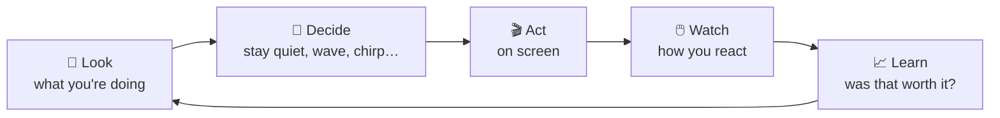

# Buddy

**A tiny desktop companion that learns, all by himself, when you'd like a hello and when you'd rather be left alone.**


Buddy is a small mint-green creature with a sprout on his head who lives in the corner of your Windows desktop. He notices what you're doing (coding, browsing, gaming, watching, chatting), and every so often he tries to get your attention: a wave, a hop, a chirp, a few words in a speech bubble, a little walk toward your cursor.

What makes Buddy different is that **nobody tells him when to do that**. He learns it from you, with reinforcement learning. Click him and he learns that was a good moment. Push him aside and he learns it wasn't. Over days he works out your rhythms: that a hello after a coffee break is welcome, that a chirp in the middle of a game is not, and that pestering you twice in a row never pays.

And he does it **100% on your computer**. Buddy makes no network connections, records *when* you type but never *what*, takes no screenshots, and stays light: around 15 MB of memory and next to no CPU.

---

## What Buddy can do

### Things he decides to do

These are the seven actions Buddy chooses between. Which one, and when, is what he learns.

| | Action | What it looks like |
|---|---|---|
| | **Stay quiet** | Nothing extra. Most of the time this is the right call, and Buddy knows it. |
| | **Fidget** | Peeks left, peeks right, hops back to the middle. Barely noticeable on purpose. |
|  | **Wave** | Raises a hand above his shoulder and waves, grinning. |
|  | **Bounce** | Two hops with a proper wind-up, stretch and landing squash. |
|  | **Chirp** | A quick hop, a little "o", a short chirp sound and two floating notes. |
|  | **Speak** | A speech bubble pops up and types out a line that fits the moment. |
|  | **Walk to you** | Hop-walks across the screen toward your mouse cursor. |

### Things he does on his own

| | When | What happens |
|---|---|---|
|  | You click him | A springy bounce, happy eyes and a heart. |
|  | You pick him up | He dangles, kicks his feet and swings behind the way you carry him, then lands with a squash. |
|  | You've been away 5 minutes | A big yawn and stretch, his sprout droops, and the Zs start. |
|  | You come back | He blinks awake, stretches with both arms up, and his sprout springs back. |

And always, underneath: he breathes, blinks, and his sprout sways a little.

### Things he says

Buddy has about 150 lines and picks one that fits: a good morning, a nudge to stretch after two hours of code, a "welcome back" after a break, a Friday-afternoon cheer, a gentle "it's late" at 2 a.m. If he thinks he's been annoying, he switches to short, humble lines. He remembers what he said recently, so he won't repeat himself for a long while. With `-voice`, he reads them aloud with the voice built into Windows.

### Things he will never do

Buddy stays completely still and silent while you're **on a call** (any app using your microphone or camera), **presenting**, or using an app **full screen**. This isn't something he learns; it's a rule he can't break.

---

## How Buddy learns

Every 30 seconds, and right away when you switch apps, leave or come back, Buddy goes around this loop:



### What he looks at

Only a handful of things, all of them coarse:

- **Which kind of app** is in front: code, browser, game, media, chat or other. He reads the app's name to tell which, and a browser tab's title only to tell a video site from the rest. Titles are never stored.
- **How long since your last key press or mouse move**, and **how busy your input has been** over the last minute. He asks Windows *when* you last typed, never *what*.
- **How long** you've been in the current app, and **the time of day**.
- **How annoyed he thinks you are.** This goes up when you ignore him or push him away, and fades over about 20 minutes.
- **How long since he last tried** to get your attention.

### How he scores himself

| Your reaction | Reward |
|---|---|
| You click him | **+1** |
| You ignore him | 0 |
| You drag him out of the way | **−0.5** |
| You send him away (right-click → Go away) | **−2** |
| You play with him (wiggle him or carry him around) | 0, playing says nothing about the attempt |

On top of that, every attempt costs a little, and interrupting while you're typing hard costs more. So Buddy learns **restraint**, not just timing. A reaction that comes a bit late, say a dismissal 40 seconds after a wave, still counts against the wave.

### Why this is reinforcement learning

Buddy doesn't just learn "what works right now". His guess at your annoyance is part of what he sees, so pestering you now leads to worse situations later. With a discount factor of 0.9, he plans a few minutes ahead and learns that spamming never pays, even when a single extra wave might get a click.

### His two brains

Buddy comes with two interchangeable learners and uses whichever proved better:

- **The Q-table.** A lookup table of about 7,800 situations × 7 actions. Every situation is learned on its own. It's simple, transparent and stable.
- **The neural network.** A small **Double DQN** written from scratch in Go: 14 inputs, two hidden layers of 32 neurons, one output per action. It learns from a replay memory of past moments, against a slowly updated copy of itself, with the Adam optimizer. Its big advantage is that it **generalizes**: learning that you enjoy a hello while browsing in the afternoon tells it something about browsing in the evening too. Two details keep it well behaved. It replays its attempts and its quiet moments from separate memories, so rare attempts aren't drowned out. And it only acts when an attempt looks *clearly* better than staying quiet, which stops it from getting pushy.

### Practice before meeting you

A brand-new Buddy would be clueless, and random experiments on a real person are annoying. So `buddysim` lets him practice first against a **simulated person**: a toy model of someone who codes, browses, games, watches videos, takes breaks and goes to bed. It's built on common sense (don't interrupt games, people like a hello after a break), not on data about anyone. Thousands of simulated days take under a minute, and both brains are trained and scored. Then your real reactions take over, and Buddy keeps adapting as your habits change.

He still experiments a little (2% of his decisions are random tries) so he can discover things the simulation got wrong. While you're typing hard, he only experiments with calm actions.

---

## Getting started

You need Windows 10 or 11. To build from source you also need [Go](https://go.dev/dl/) 1.26 or newer. No C compiler is needed.

### From a release

1. Unzip `buddy-<version>-windows-amd64.zip` anywhere you like.
2. Run `buddysim.exe` once. Buddy practices for about a minute.
3. Run `buddy.exe`. Buddy appears at the bottom right of your screen and in the notification area.

### From source

```sh
go run ./cmd/buddysim      # practice first, takes about a minute
go run ./cmd/buddy         # meet Buddy
```

To build a release zip with Buddy's icon and no console window:

```powershell
.\scripts\build.ps1 -Version 1.0.0     # writes dist\buddy-1.0.0-windows-amd64.zip
```

---

## Living with Buddy

| You | Buddy |
|---|---|
| **Click** him | Happy bounce. Counts as "good timing". |
| **Drag** him somewhere else | Moves there. A clear move away counts as "not now". |
| **Wiggle or carry him around** | He dangles and swings. Counts as play, not as a complaint. |
| **Right-click** him | Menu: *Go away for 30 minutes* (a strong "no"), plus everything in the tray menu. |
| **Click the tray icon** | *Pause for 1 hour*, *Sound* on/off, *Start with Windows*, *What has Buddy learned?*, *Quit Buddy*. |
| **Leave** for 5 minutes | He yawns and naps until you're back. |

Clicks on the empty space around Buddy go through to whatever is underneath, and clicking Buddy never takes the keyboard away from what you're typing in.

### What has Buddy learned?

Pick **What has Buddy learned?** from the menu and a page opens in your browser (it's a local file and works offline). You get:

- **Pick a moment.** Choose a situation (deep in code, relaxed browsing, late-night video, just sent away...) and see what Buddy notices, how much better or worse than staying quiet he expects each action to go, and a sentence explaining his choice.
- **Inside his neural network.** A live diagram of the network for that moment: the inputs on the left, two layers of 32 neurons lit up by how active they are, one output per action, and the connections carrying the most signal, blue pushing up and red pushing down. Hover over anything for numbers.
- **His playbook.** What he would do for every app and situation, morning, afternoon, evening and night.
- **How it's going.** What happened after each kind of attempt, and how often you clicked him, week by week.

For a plain-text version, run `go run ./cmd/buddy -report` (the release `buddy.exe` has no console to print to), or `buddy -report-html page.html` to save the page anywhere. A shortened example of the text version:

```text
What Buddy would do now, on a calm afternoon
app      typing hard     relaxed         just switched   2h in
code     quiet           quiet           fidget (+0.02)  speak (+0.21)
browser  quiet           wave (+0.12)    fidget (+0.03)  speak (+0.18)
game     quiet           quiet           quiet           quiet
chat     quiet           chirp (+0.14)   fidget (+0.03)  fidget (+0.04)

Is it getting better? Week by week
week of  attempts  clicked  click rate  sent away
Mar 2          31       11         35%          3
Mar 9          22       12         55%          1
```

*(Illustrative numbers.)*

### Options

| Flag | Default | Meaning |
|---|---|---|
| `-voice` | off | Also read speech bubbles aloud with the Windows voice |
| `-brain` | `auto` | `table`, `network`, or `auto` for whichever scored better in practice |
| `-report` | | Print what Buddy has learned and exit (needs a console, so use `go run`) |
| `-report-html` | | Write the visual "what has Buddy learned?" page to a file and exit |
| `-data` | `%AppData%\buddy` | Where Buddy keeps what he learns |
| `-v` | off | Log every decision |

`buddysim` takes `-brain table|network|both`, `-days` and `-net-days` (how long each brain practices), and `-force` to replace brains that already exist. Replacing them makes Buddy forget what he learned from you.

---

## Privacy

Everything Buddy knows lives in one folder, `%AppData%\buddy`. Delete it and he forgets everything.

| File | What's in it |
|---|---|
| `qtable.json`, `network.gob` | His two brains: numbers, no text about you |
| `buddy.db` | A log of his attempts and your reactions, with only the coarse situation (like `code/active/input-high/app-1h+/evening/calm/last-15m+`) |
| `said.json` | The lines he said recently |
| `settings.json` | Your tray menu choices |
| `buddy.log` | Diagnostics, kept under 1 MB |

He never stores window titles, never records keystrokes (there are no keyboard hooks at all), takes no screenshots, and never connects to the network.

---

## Light by design

Buddy is drawn on the CPU into a 240×200 bitmap and shown in a transparent "layered" window, so he never loads a graphics driver. While resting he redraws a few times a second, and fast only while something moves. He typically uses around 15 MB of RAM and a fraction of a percent of one CPU core. Learning a step takes well under a millisecond.

---

## FAQ

**Why doesn't Buddy do much?**
Staying quiet is usually right, and he knows it. Most of his "personality" is deciding *not* to interrupt you. If you'd like more from him, reward him: click him when he says hi.

**Why doesn't he walk toward me more often?**
During practice, the simulated person found a character walking toward their mouse fairly intrusive, so Buddy starts out cautious about it. If you click him when he does, he'll learn that *you* like it.

**He sneezed out a chirp during a meeting!**
He shouldn't: he goes still whenever an app is using your microphone or camera. If your meeting app doesn't register microphone use with Windows (for example, you're muted at the system level), the rule can't see it. Use *Pause for 1 hour* from the tray.

**Can I reset him?**
Quit Buddy, delete `%AppData%\buddy`, and run `buddysim` again.

---

## Under the hood

```
cmd/buddy          the app: wiring, logging, single instance
cmd/buddysim       practice against the simulated person
internal/activity  app categories and activity snapshots
internal/sense     Windows watcher: foreground app, input timing, calls, full screen
internal/rl        the brains: Q-table, Double DQN, rewards, annoyance
internal/brain     the look, decide, act, watch, learn loop
internal/sim       the simulated person
internal/store     SQLite log of attempts and reactions
internal/report    the "what has Buddy learned?" report
internal/ui        the transparent window, the drawing, animations, tray menu
internal/voice     what Buddy says, and the optional Windows voice
internal/settings  tray menu switches
internal/autostart start with Windows
tools/mkres        draws Buddy's icon into buddy.exe
```

Everything is written in Go with no machine-learning framework and no graphics engine. The neural network, the drawing and the animation are all plain code you can read.

### Development

```sh
go vet ./...
go test ./...
BUDDY_SNAPSHOTS=/some/folder go test ./internal/ui   # every pose as PNG, every animation as GIF
```

The race detector needs cgo and a C compiler, so `go test -race` only works where one is installed.
